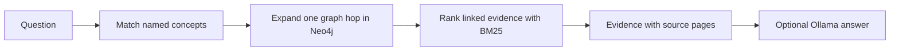

# GraphRAG for Engineering Handbooks

A small, reproducible GraphRAG demo over selected passages from NASA's *Systems Engineering Handbook* (NASA/SP-2016-6105 Rev 2).

The application stores concepts, relationships, and source passages in Neo4j. A question first finds concepts mentioned by name, expands to directly connected concepts, and ranks their evidence passages with BM25. If an Ollama model is configured, it writes a short answer from those passages and cites the printed handbook page. Without a model, the CLI returns the evidence verbatim.

This is an independent portfolio project. Its code and graph annotations were written for this demo. It does not contain code, results, or documents from the author's Master's thesis.

## Example

```text
$ python -m app.cli ask "How do verification and validation differ?"

Answer
Verification checks whether the product meets its documented requirements. Validation checks whether it is the right product for users in its intended environment. [NASA, p. 103] [NASA, p. 116]

Graph context
Seeds: product verification, product validation
Expanded concepts: requirements, stakeholder expectations, intended environment

Evidence
[NASA, p. 103] Product verification proves that an end product ... conforms to its requirements or specifications.
[NASA, p. 116] Verification proves whether “the product was done right,” while validation proves whether “the right product was done.”
```

The exact generated wording can vary by model. The source excerpts and page references are fixed. The example is illustrative and has not been benchmarked across models.

## Architecture



The graph annotations are curated by hand from the cited source. This keeps the demo small and makes every edge reviewable. It does not claim to automatically extract a knowledge graph from arbitrary PDFs. Retrieval uses lexical entity matching and BM25, not vector embeddings.

## Requirements

- Python 3.11 or newer
- Docker with Docker Compose
- Optional: Ollama running locally and a model already installed

The Neo4j Python driver is the only Python dependency. The application calls Ollama's local HTTP API with Python's standard library.

## Run it

```bash
cd graph-rag-engineering-handbook
cp .env.example .env
```

Edit `.env` and set a local Neo4j password. Then start the database and install the driver:

```bash
docker compose up -d
python3 -m venv .venv
source .venv/bin/activate
pip install -r requirements.txt
```

Load the sample graph and ask a question:

```bash
python -m app.cli ingest
python -m app.cli ask "What is the purpose of end-to-end testing?"
```

To generate a natural-language answer with a local Ollama model, set `OLLAMA_MODEL` in `.env` and make sure that model is already installed in Ollama:

```bash
export OLLAMA_MODEL="mistral:7b"
python -m app.cli ask "How does NASA describe technical risk management?"
```

If `OLLAMA_MODEL` is unset, the program prints the retrieved evidence without calling a model. The model is optional so the graph and retrieval can be inspected without loading an LLM.

Stop Neo4j when finished:

```bash
docker compose down
```

## Evaluate retrieval

The small hand-labelled question set reports Recall@3 and reciprocal rank for its expected evidence passages:

```bash
python -m app.cli evaluate
```

This measures retrieval only. It does not measure answer correctness, hallucination rate, or performance on unseen handbooks. Add questions and expected passage IDs in `data/questions.json` before drawing broader conclusions.

## Data and source

The sample passages are short excerpts from the NASA handbook. NASA's Technical Reports Server lists the report as public and states “Public Use Permitted.” The PDF itself is not bundled; each passage includes the source and printed page number.

- [NASA Technical Reports Server record](https://ntrs.nasa.gov/citations/20170001761)
- [NASA handbook page](https://www.nasa.gov/reference/systems-engineering-handbook/)
- [Neo4j Python driver manual](https://neo4j.com/docs/python-manual/current/)
- [Ollama chat API](https://docs.ollama.com/api/chat)

The MIT license applies to this project's code. The NASA excerpts retain their source attribution and are not relicensed by this repository. See [NOTICE.md](NOTICE.md).

## Project map

```text
app/                 Neo4j ingestion, graph retrieval, optional generation, CLI
data/                Curated concepts, relations, passages, and retrieval questions
docker-compose.yml   Local Neo4j instance on port 17687
NOTICE.md            Source and reuse notes
```
